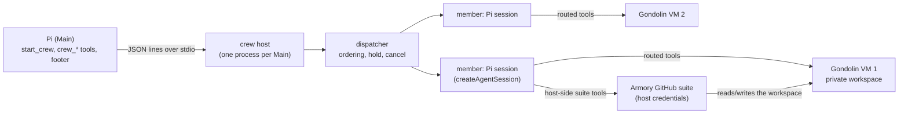

# Architecture

How a Crew runs today. The earlier Comm/Lifecycle runtime (`extensions/crew/crew-runtime/`) is kept for the
backend scale-up. Its extension entry point is not loaded, but some modules are still used, including
`lib/crew-terminal-notifier.mjs`; its design notes are elsewhere in this directory.

## Shape

- **Main** validates and assembles a crew (roles, personas, tool grants: unchanged), then sends one `launch`
  command. Results, state changes and live counters come back as events and `status` answers.
- **The crew host** is a separate process so a crash in a member or a `/reload` of Main cannot take the
  other down. It exits when Main's stdin closes, closing every VM first. A guardian process removes VMs if
  the host itself is killed.
- **Each member** is a real Pi session. Its built-in tools keep Pi's logic and run on the host, but their
  operations execute inside the member's own VM. Raw shell is granted per role.
- **Armory tools** (typed Git, pull requests) run on the host as Pi extensions loaded from a verified
  Armory source artifact. They act on the member's workspace through the host's view of it. Host credentials
  never enter the VM, whose network is deny-by-default.

## Dashboard

The Automata tab shows each member's turns, tool calls, errors, input and output tokens, cache reads and
writes, and context usage as a percentage of the model window. The context cell also shows the model window;
unknown values appear as dashes. The dashboard also has a Plan tab.

## Outcomes

The runner decides, from the session's messages and facts it recorded itself:

| Outcome       | When                                                                        |
| ------------- | --------------------------------------------------------------------------- |
| `completed`   | The last assistant message stopped normally with non-empty text             |
| `needs_input` | The member called `request_input`; the same session continues on the answer |
| `failed`      | A provider error (a fixed category), an empty turn, an abort or other stop  |
| `cancelled`   | Main cancelled it; the guest process group is killed                        |

A member that fails or asks a question is **held** with its dependents, not terminal. Only a cancel ends it.
When a run ends, salvage is best-effort for members granted typed Git commit and push: the runner attempts to
commit and push uncommitted work to the member's `crew/<run>/<member>` branch. Salvage failure is reported
beside the result.

## Trust and limits

- A VM is fail-closed: no host fallback.
- A repository is authorized as one exact repo, revision and branch; other refs, force pushes and
  other refspecs are refused. Git operations are pure JavaScript and run no hooks.
- Tokens are never written to files, logs or transcripts; failures report fixed categories.
- No automatic time limits. Cancel and manual intervention instead.

## Known limits

- A crew does not survive its host: if the host dies, running members are gone (their pushed branches are
  not). Durable recovery is part of the backend stage.
- One host per Pi. Several Pis on one machine each run their own.
