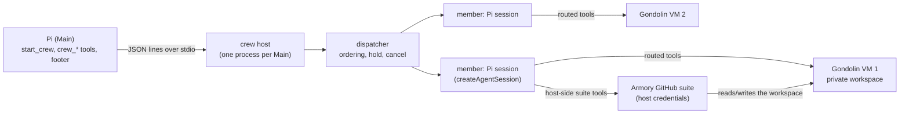

# Architecture

How a Crew runs today. The earlier Comm/Lifecycle runtime (`extensions/crew/crew-runtime/`) is kept for the
backend scale-up. Its extension entry point is not loaded, but some modules are still used, including
`lib/crew-terminal-notifier.mjs`; its design notes are elsewhere in this directory.

## Shape

- **Main** validates and assembles a crew (roles, personas, tool grants: unchanged), then sends one `launch`
  command. Results, state changes and live counters come back as events and `status` answers.
- **The crew host** is a separate process so a crash in a member or a `/reload` of Main cannot take the
  other down. It exits when Main's stdin closes, closing every VM first. A guardian process removes VMs if
  the host itself is killed.
- **Each member** is a real Pi session. Its built-in tools keep Pi's logic and run on the host, but their
  operations execute inside the member's own VM. Raw shell is granted per role.
- **Armory tools** (typed Git, pull requests) run on the host as Pi extensions loaded from a verified
  Armory source artifact. They act on the member's workspace through the host's view of it. Host credentials
  never enter the VM, whose network is deny-by-default.

## Dashboard

The Automata tab shows each member's turns, tool calls, errors, input and output tokens, cache reads and
writes, and context usage as a percentage of the model window. The context cell also shows the model window;
unknown values appear as dashes. The dashboard also has a Plan tab.

## Outcomes

The runner decides, from the session's messages and facts it recorded itself:

| Outcome       | When                                                                                                           |
| ------------- | -------------------------------------------------------------------------------------------------------------- |
| `completed`   | The last assistant message stopped normally with non-empty text, and, if it opened a pull request, CI is green |
| `needs_input` | The member called `request_input`; the same session continues on the answer                                    |
| `failed`      | A provider error (a fixed category), an empty turn, an abort or other stop                                     |
| `cancelled`   | Main cancelled it; the guest process group is killed                                                           |

### Member lifecycle

`runner/member-lifecycle.mjs` defines it. Each member has exactly one current `state`: `queued`, `held` (a
prerequisite is not complete), `running`, `ci`, `needs_input`, `failed`, `on_hold`, `completed`, `handed_off` or
`cancelled`. Only `completed` releases dependents, and it means the model finished and the CI gate passed or found
no checks: it is not review approval or acceptance.

Main decides what happens to a member that waits for it (`needs_input`, `failed` or `on_hold`):

- **`crew_message`** resumes it with exactly one turn. Every message resumes; the runner never judges prose.
- **`crew_hold`** records a blocker, its owner, a resume condition and optional PR/head/artifact references.
  The member becomes `on_hold`, keeps its VM, and starts no turn; nothing polls or expires. A message resumes it.
- **`crew_handoff`** ends it as `partial` or `superseded` work with its unmet criteria and saved evidence (pull
  request, pushed head, last CI snapshot, salvage). Its VM is released; its node stays blocked, so dependents
  never start on it. A later message recovers it in a new session given its assignment and the handoff.
- **`crew_cancel`** ends it; its node fails and its VM is released.

Holds and handoffs are recorded in the run's `events.jsonl` as `decision` events and are not delivered as
reports. `crew_status` shows, beside the state, `lastReport` (the latest report's status and time, `current`
only while the member is still in that state), `ci` (state, `pullNumber`, `headSha`, `checkedAt`; only `success`
is green, `none` and `unavailable` are not), and the current `hold` or `handoff`.

### The CI gate

A member that opened a pull request is not `completed` when it stops talking, but when CI says so. The runner
reads the pull request and the last pushed commit from the run's evidence (what the tools returned, never what
the model said) and asks the Armory's `github_pull_request_checks_wait` to wait for that commit's checks. While it
waits the member's state is `ci`.

- **Green:** the member completes and the result carries the checks.
- **Red:** the same session is resumed with each failing check and its log tail, so the member fixes the cause
  and pushes. After five attempts the member becomes `needs_input` instead of looping.
- **No CI, a closed pull request, or CI that cannot be checked:** reported as such; the last two ask Main.
- **Green but the checks were weakened:** if the pull request touches the files that define them (workflows,
  formatter and linter ignore lists and configs, test-runner configs) the member asks Main, and once Main
  replies those files are accepted for that member. This exists because a member told to make CI pass once did
  exactly that by adding its file to `.prettierignore`.
- **Cancel** ends the wait.

A member that fails or asks a question is **held** with its dependents, not terminal. Only a cancel or a handoff
ends it.
When a run ends, salvage is best-effort for members granted typed Git commit and push: the runner attempts to
commit and push uncommitted work to the member's `crew/<run>/<member>` branch. Salvage failure is reported
beside the result.

## Trust and limits

- A VM is fail-closed: no host fallback.
- A repository is authorized as one exact repo, revision and branch; other refs, force pushes and
  other refspecs are refused. Git operations are pure JavaScript and run no hooks.
- **Pull requests:** Crew enforces draft creation for developers. They can list and read PRs in the authorized
  repository (including files, checks and review threads), but can change only their own PR's title, body,
  open/closed state and labels. They cannot comment, request changes, approve, merge or mark a PR ready;
  reviewers, Main and humans handle review and landing.
- Tokens are never written to files, logs or transcripts; failures report fixed categories.
- No automatic time limits. Cancel and manual intervention instead.

## Known limits

- A crew does not survive its host: if the host dies, running members are gone (their pushed branches are
  not). Durable recovery is part of the backend stage.
- One host per Pi. Several Pis on one machine each run their own.
