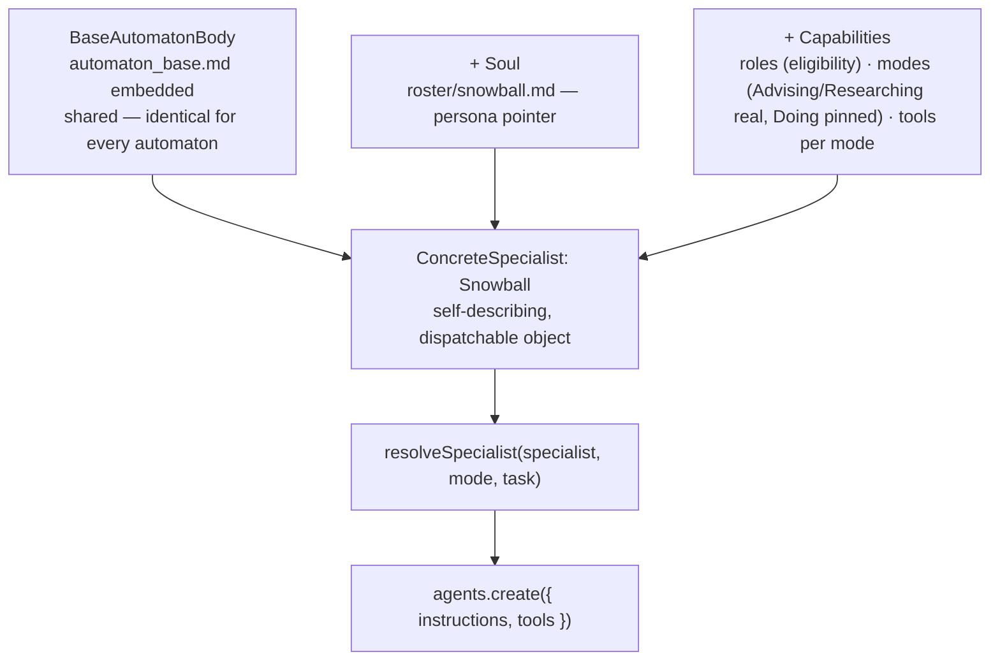
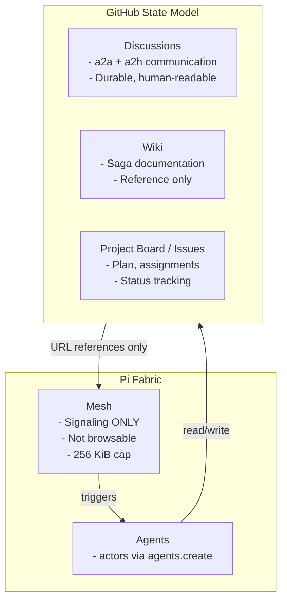
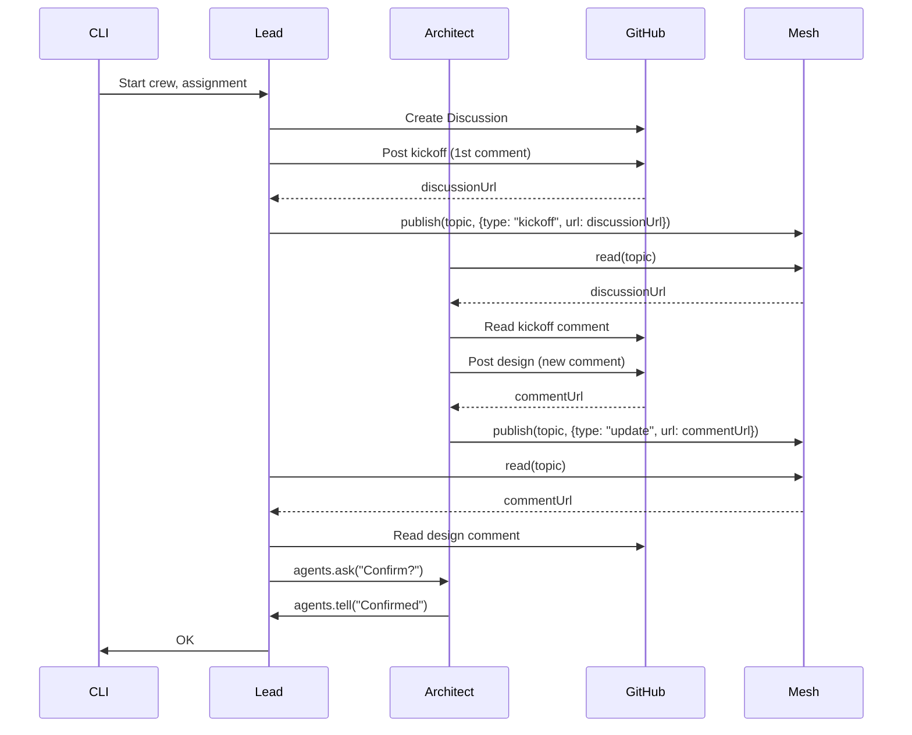

_Saga type: infrastructure migration. Repo: hall-of-automata-cli. Status: open. Filed: 2026-07-20._

---

## Design Doc

### Background

Hall of Automata CLI is a Claude Code plugin. The invoker opens a session, Old Major persona mounts as a general methodology, and every skill invocation runs inside the Claude Code runtime. 

Pi (pi.dev) is an open-source harness, MIT-licensed, TypeScript-native extension API, forkable, with native support for 15+ model providers and mid-session switching.

### Problem Statement

The current Hall of automata cli has three hard limits, addressable by porting the plugin to Pi.

**Model lock-in.** Claude Code is Anthropic-only. An invoker who prefers GPT-4o, Gemini, or a locally-hosted model cannot use it — the harness decides the model, not the invoker or the dispatch system. As A2T and other Hall users grow, this becomes a sourcing and cost constraint with no workaround inside the current architecture.
- Pi is model-agnostic: 15+ providers
 
**Closed extension surface.** Hall's entire plugin capability — hooks, session stack, tool access, skill loading — is bounded by what Anthropic exposes through the Claude Code plugin API. 
- Pi has no built-in permission model
- Pi offers a wider span of hooks
- Pi's extensions areCustomisable tools registered at runtime

**Conversation dilution** — a known Hall limitation, not specific to this repo. As a session runs longer, `old-major-cli.md`'s instructions compete with an ever-growing pile of conversation and tool output for salience; behaviour that holds at turn 5 can drift by turn 50. Currently it loads the full persona carrying methodology, long running conversation dilute the methodology (already stacking on claude system prompts) and the LLM may end up `interpreting` it leading to dirty outputs.
- Pi features ~10–20× tokens reduction for system prompting
- Pi's extension code never enters the LLM's context
- Pi's extensions cost zero incremental context
- Pi Progressively loads skills — full instructions loaded only on invocation

### Product Definition

Hall of Automata CLI is a local orchestrator that lets one invoker run a fleet of specialist coding agents without personally relaying instructions, tracking status, or reviewing every diff by hand. Old Major is the single conversational interface to that fleet — he talks, plans, and delegates; he never touches code himself.

Old Major's feature is end-to-end product design-to-implementation, autonomy-tunable at every stage:

1. **Design** — a standard methodology applied implicitly through conversational flow; the invoker talks, Old Major judges how much process the ask needs, and produces a living design document for initiative-sized work.
2. **Goal Formalization** — the design is translated into goals: Objectives → Key Results, via a structural gate that blocks skipping straight to a ticket, not a style guideline.
3. **Plan** — goals are decomposed into dispatchable tasks (Items) and batched into execution waves.
4. **Execute & Track** — a closed execution loop: route tasks to specialists (Hall-native specialist matching, a named roster the invoker never has to know), dispatch waves, review PRs, merge or kick back, and update the plan against live GitHub state. Multi-invoker safety prevents collision across invokers sharing the loop.

Running through all four: **Continuity via GitHub state** — GitHub (issues, PRs, board, wiki) is the durable, developer-visible continuity layer across sessions; local agent memory is short-term bridging only, never the source of truth.

### Feature Mapping

Each pipeline feature mapped to the skill(s) that implement it today. Starting point for refinement.

| Feature | Skill(s) |
|---------|----------|
| Design | `hall-saga` |
| Goal Formalization | `hall-okr` |
| Plan | `hall-decompose` |
| Execute & Track | `hall-route`, `hall-dispatch`, `hall-review`, `hall-reply`, `hall-status` |

**Session/local-state lifecycle mechanic (not a feature):** `hall-open`/`hall-close` — persona injection, agent index build, invoker verification gate, cron resume for in-flight work, live board/issue/wiki peek. `hall-prune` bookends it — cleans the local state `hall-open` provisions. Wraps every session; not a pipeline stage.

### Migration Strategy

Feature-by-feature, not a rewrite. Four stages, in order:

1. **Prototype spike — standalone, unwired, throwaway if it doesn't hold up.** Minimal Fabric code: one persona registered as an actor, one mesh topic, one Discussion mirror, a fake task. Not connected to real Hall dispatch. Purpose is narrow: confirm the two load-bearing assumptions still marked "confirmed from docs, not from a live actor" in the Crew appendix actually hold — the `tools: ["bash"]` grant, and mailbox delivery timing. If either doesn't behave as documented, this is where that surfaces, before anything real depends on it.

2. **First real migrated feature is the simplest one, not Crew.** A single-specialist Stage Dispatch — no squad, no mesh, no lead — porting one existing consultation-style specialist call. Validates the basic loop (fresh-context actor, Hall persona injected via `instructions`, synthesis written to GitHub, pointer back) without also debugging the squad mechanism at the same time.

3. **Second migrated feature is the first one that actually needs Crew** — `hall-saga` Phase 3, the research/fact-checking work this saga's own design conversation started from. By this point the dispatch loop is already proven; only the squad/mesh/lead layer is new.

**Repo shape for coexistence:** a `dev` branch, new top-level directory for the Fabric-side code (`pi/`, alongside the existing `skills/`, `methodology/`, `templates/`). The current Claude Code plugin stays untouched and shippable from `main` throughout — nothing about the live plugin's behavior changes until a migrated feature is actually ready to cut over. `dev` is where Pi-side code accumulates and gets tested in isolation, feature by feature.

**Release gate:** a migrated feature isn't clean-to-release until it passes the same verification harness **[[Saga-3-The-Gauntlet-of-Wits-[complete]]]** already built for the Claude-plugin version of that feature — same golden task, same judge, compared outcome. Existing asset, not new work; the difference between "looks right" and "proven equivalent" before anything merges to `main`.

### Verification and testing — moved

Split out 2026-08-01 into its own cycle: **[[Saga-3-The-Gauntlet-of-Wits-[open]]]**. That saga's scope (state-model checks, golden-task sandbox, Popotron judge, CI wiring) grew large enough on its own to warrant separate OKRs rather than riding under the Pi-migration objective.

### Appendix

**The Crew concept — squad dispatch for conversation dilution**

Applies to Problem 3 (conversation dilution). A "Stage Dispatch" is the atomic unit Old Major hands off for any pipeline stage — Design, Goal Formalization, Plan, or Execute & Track — whether it needs one specialist or several. Old Major sends in only a task statement and GitHub pointers, never conversation history; it gets back a URL and one status line. What happens in between is the Crew.

*Substrate:* `pi-fabric`'s persistent actors (`agents.create({name, instructions, topics, tools, ...})`) — the only researched primitive confirmed to give per-actor custom persona injection (`instructions`), native durable pub/sub (`mesh.publish`/`mesh.read` on topics), and a shell tool grant (`bash`), all in one package. `pi-dynamic-workflows` and `pi-messenger` were both evaluated and set aside: composing them would have required an unconfirmed cross-package extension-loading behavior neither package documents.

*A2A mechanism, confirmed:* `mesh.publish({topic, to?, text, data})` / `mesh.read(...)` is a durable, sequenced, replayable event log — Fabric's own state layer, not something Hall has to build. Actors auto-subscribe via `agents.create({topics: [...]})`; a publish to a subscribed topic is delivered to every member without a separate explicit ping. `to` set → direct message to one actor; `to` omitted → broadcast to the whole topic. `agents.tell`/`agents.ask` remain available for messaging outside the topic model (`ask` blocks for a reply — useful for the lead's Review step to synchronously confirm a specialist considers something resolved).

*Delivery timing, confirmed and accepted as sufficient:* actors never interrupt mid-task — *"actors handle one message at a time."* All delivery modes (`mailbox`, `steer`, `followUp`, `nextTurn`) feed the same serial mailbox; they differ only in when a message becomes available to be picked up, never whether current work pauses. `triggerTurn` (the only proactive wake) applies to Main only, not actor-to-actor. Practical effect: a message lands at the recipient's next natural checkpoint, not instantly — acceptable for this use case since nothing here needs sub-second turnaround, only reliable pickup. Worth writing into specialist instructions: check the topic between sub-steps of their own task, since Fabric doesn't checkpoint for them.

*GitHub Discussion's role narrows to human visibility specifically* — mesh state isn't browsable outside Pi tooling, so it doesn't replace the durable, human-readable record. The lead mirrors key mesh events out to a Discussion (one per dispatch) rather than routing coordination through it. `bash` tool access (confirmed grantable via `agents.create({tools: [...]})`) is what makes `gh api graphql` reachable for that mirroring — though the grant is coarse (whole tool categories, not scoped to `gh` alone), a real discipline gap relative to Hall's existing per-tool MCP allowlists, not yet resolved.

*Constraint on record:* mesh/recursion/`fabric_exec` require the Pi runner specifically — an actor created with `runner: "claude"` cannot use any of it. Shouldn't bind Hall post-migration, but worth having written down. Mesh events also cap at 256 KiB, with `data` truncating (`fabricTruncated: true`) past budget — another reason specialist findings posted to a topic need to stay summaries, not raw dumps.

*The lead — four responsibilities, not one vague "coordinate" mandate:*

1. **Recruit** (once, at kickoff) — reads `agent-index.json`, decides who's needed and why, opens the Discussion and posts the kickoff: roster, each member's expertise, and who to ask about what. This is what lets a specialist mid-task decide it needs a teammate's opinion, not just react to whatever lands in front of it.
2. **Watch** (continuous, low-intervention) — stall detection (the `fabric-supervisor` shape: nudge, don't take over) plus human-comment triage on the Discussion, filtered by author. Answerable-inline comments get answered by the lead directly; anything needing domain judgment gets published to the relevant specialist's topic for them to answer, mirrored back to the Discussion. Same split as Old Major's own consultation routing (answerable from context vs. needs the specialist), one level down.
3. **Review** (gate, before closing) — checks the assembled deliverable against the stage's own discipline (e.g. `hall-saga` Phase 4 verification criteria); can use `agents.ask` to synchronously confirm a specialist's part is actually resolved. Incomplete → reiterate: re-task the relevant specialist(s) for another pass. Bounded the same way `hall-review`'s REFINE cycle is bounded — one reiteration, then escalate to Old Major/the human rather than loop indefinitely.
4. **Close** (once, at the end) — posts final synthesis to the Discussion, closes it, writes the durable artifact separately (saga wiki, issue, PR — wherever the stage's output actually belongs), returns `{discussionUrl, artifactUrl, status}`.

*Genuinely open, not yet resolved:*
- Composition logic (step 1's actual decision-making) is Hall's own skill, not a package feature — no package researched gives this for free.
- The coarse `bash` tool grant vs. Hall's existing scoped-per-tool discipline — needs an actual answer, not just a flagged gap.
- Everything above is confirmed from documentation, not from a real run — the whole shape is still unverified end-to-end.

---

## Plan

| OKR | KR | Status |
|---|---|---|
| [OKR 7 — Crew end-to-end #355](https://github.com/MockaSort-Studio/hall-of-automata-cli/issues/355) | [KR 7.1 #356](https://github.com/MockaSort-Studio/hall-of-automata-cli/issues/356) Crew's Fabric assumptions hold under a live actor | ⬜ Open |
| | [KR 7.2 #357](https://github.com/MockaSort-Studio/hall-of-automata-cli/issues/357) A single-specialist Stage Dispatch runs end-to-end on Pi | ⬜ Open |
| | [KR 7.3 #358](https://github.com/MockaSort-Studio/hall-of-automata-cli/issues/358) A full Crew squad completes a real hall-saga Phase 3 dispatch | ⬜ Open |
| | [KR 7.4 #359](https://github.com/MockaSort-Studio/hall-of-automata-cli/issues/359) The Crew-based Phase 3 implementation passes Saga 3's harness at parity | ⬜ Open |

---

## Bug Fixes

_No bug fixes logged yet._


---

## Findings from KR 7.1 spikes (updated 2026-08-26)

Items #360 and #361 ran against live `pi-fabric` actors — first two Crew assumptions now confirmed from a real run, not documentation, plus new findings the appendix above didn't anticipate.

**Mesh delivery, confirmed and timed.** A `mesh.publish` to a topic reached the subscribed actor's mailbox (visible in the actor's own session log, not inferred); its reply was independently confirmed via `mesh.read` from Main. Observed timing on one run: 1473ms mailbox delivery latency, 3208ms actor processing (real model turn), 4681ms total round trip. Confirms the "next natural checkpoint, not instant" claim with real numbers — a Stage Dispatch is multi-second minimum; design for async, not tight polling.

**`tools: ["bash"]` grant, confirmed.** An actor with the grant ran a real shell command and reported its genuine output over mesh, independently verified.

**New finding — topic subscription ignores `to` for delivery.** An actor already subscribed to a topic (`agents.create({ topics: [...] })`) receives *every* message published to that topic, regardless of the event's `to` field. `to` is metadata on the event, not a subscription filter. Reusing a generic topic name across two separate spike runs caused the Item #360 actor (still alive, still subscribed) to react to a ping addressed only to the Item #361 actor.

**Resulting discipline for KR 7.3's real Crew — pub/sub vs. ask/tell:**
- **Pub/sub (`mesh.publish`/`mesh.read` on a topic)** — lifecycle and control broadcast only: lead's stop/wait/start instructions to the whole squad, "specialist X is done" notifications. Matches how Fabric's own internal actor mechanism already uses topic-shaped event subscriptions (`agent_settled`, `tool_error`) for the same purpose.
- **`agents.tell`/`agents.ask`** — anything genuinely point-to-point. `tell` for fire-and-forget ("go look at X"), `ask` for doubt resolution (already anticipated for the lead's Review step; generalizes naturally to specialist↔specialist).
- **Content lives on GitHub, never in a mesh event.** A specialist writes its finding to the Discussion first, gets the comment URL back, *then* `tell`s the peer with that URL — never the content itself. Directly avoids the mesh event size cap (256 KiB, truncates past budget) and keeps the no-local-mirror discipline consistent: mesh is a live signal that something changed, GitHub is the only place the something actually lives.
- **Sequencing matters**: write-then-tell must be strictly ordered (post, get the URL back, only then notify) — a fast `tell` racing a slow Discussion write means the peer reads nothing.
- **Topic scoping**: use a per-dispatch topic (e.g. `crew.<runId>`), not a shared generic name — the #360/#361 cross-talk was caused entirely by topic reuse across unrelated runs.
- **Open decision, not yet resolved**: does every specialist get real Discussion-write access (multiplies the `bash`/`gh` tool-grant surface beyond the lead), or does content-writing stay lead-mediated (specialists ask the lead to post on their behalf, reintroducing a translation step)? Needs an explicit answer before KR 7.3, not a default.

**Resolution path for the coarse `bash` grant gap.** `pi-git-extension` (chore, #363) currently ships as a plain Node CLI invoked via `pi.bash` — still requires the full, coarse `tools: ["bash"]` grant, no narrower than before. The real fix, confirmed from `pi-fabric`'s own component-registration pattern (`context.provide()`, a genuine Fabric provider namespace): register the same GitHub actions as a proper component instead of a shell-invoked CLI. A specialist could then call e.g. `tools.call({ref: "git.subissueAdd", ...})` with `tools: []` — **zero shell access at all** — since Fabric providers are reachable through `fabric_exec` independent of the `tools` allowlist (which only ever gates the portable core set: read/grep/find/ls/bash/edit/write). Sequencing: extract into a real component only after KR 7.3 exercises the action set for real, not before — same reasoning as staging the spike scripts ahead of the squad.

**Not currently in scope, resolved for the record**: KR 7.3's specialists (`hall-saga` Phase 3, research/fact-checking) need `read`/`grep`/`find`/`ls` plus the scoped GitHub-write component — no `edit`/`write`/`bash`, since they investigate and report, not implement. If a future Crew squad ever needs to write code, `edit`/`write` don't require `bash` at all (separate tool categories); for running specific commands (tests, builds) without an open shell, `fabric-schema`'s `trusted_command` evidence type (a static, host-configured, named allowlist — "names resolve to static host configuration," never free-form shell) is the existing Fabric mechanism, same least-privilege principle as the GitHub component. The real code-implementation dispatch (specialists opening PRs) stays entirely on the existing Claude Code plugin path, untouched by this migration.


---


## Appendix — Automaton 2.0

A redefinition of what a Hall specialist *is*, developed while working KR 7.2. Not a Claude-plugin change — this exists only on `dev`, exercised for the first time by KR 7.2's own dispatch (#365/#366). Written down here because it changes the shape of every specialist dispatch from KR 7.3 onward, not just this one.

### The problem with the current shape

Today a specialist is one markdown file (`roster/<name>.md`), read and pasted into a subagent overlay wherever needed, with tool access decided ad hoc per invocation. Nothing about *what a specialist can be asked to do*, or *what it's granted for each*, is explicit or reusable — it lives in whoever's dispatching it remembering to get it right each time.

### Soul and body

**Soul** — `roster/<name>.md` only. Character, tone, domain, scope. Pure narrative, live-fetched from `hall-of-automata`, never cached (same discipline as everything else in this migration — GitHub is the state). Nothing structural belongs here.

**Body** — everything structural, newly made explicit:

1. **Base Contract** (`agents/automaton_base.md`) — shared, identical for every automaton, fetched once: environment rules, identity rules, output format, the **Modes table** (`Doing` / `Advising` / `Researching` — Hall's own real behavioral-mode vocabulary, reused rather than inventing new terms), and the draft-PR-on-blocker procedure. The Pi-side merge adapts this — GitHub-Actions-runner-specific content (`/github/workspace`, the `.hall/` checkout) doesn't apply to a Pi actor and is dropped, not blindly pasted.
2. **Mode capability profiles** — new, ours: for a chosen mode, which overlay contract applies and which tools get granted.

### A specialist is derived, not merged

A specialist isn't two peer things pasted together — it's a concrete object **derived from a shared base**, enriched with that specialist's own soul and capabilities. Closer to a base class and its instances than a pile of text files.

```ts
type BaseAutomatonBody = {
  baseContract: string; // agents/automaton_base.md, embedded, identical for every automaton
};

type ConcreteSpecialist = BaseAutomatonBody & {
  name: string;
  soul: { repo: "hall-of-automata"; path: `roster/${string}.md` }; // persona pointer, not raw text
  roles: string[];                                                    // from agents.json catalog.roles — eligibility source, never widens a tool grant
  modes: Partial<Record<Mode, ModeProfile>>;                          // capability per mode, chosen per dispatch
};

async function deriveSpecialist(name: string): Promise<ConcreteSpecialist> {
  const base = await fetchBaseAutomatonBody();          // shared, same call for every specialist
  const { catalog } = await fetchAgentsJsonEntry(name);  // roles only — eligibility, not tools

  return {
    ...base,
    name,
    soul: { repo: "hall-of-automata", path: `roster/${name}.md` },
    roles: catalog.roles,
    modes: {
      advising:    { overlay: "consultation", tools: ["local.read", "github.read", "github.comment"] },
      researching: { overlay: "consultation", tools: ["local.read", "github.read", "github.comment"] },
      // doing: pinned — not attached until a future saga explicitly authorizes real code writing
    },
  };
}
```

`deriveSpecialist("snowball")` produces one self-describing, dispatchable object — everything Snowball can be asked to do, and under what constraint, in one place. `resolveSpecialist(specialist, mode, task)` is then a thin final step: pick a mode, merge `baseContract + soul + mode overlay + task` (matching the Claude-plugin's own existing assembly order — base first, persona second, task-specific contract third), and produce `agents.create()`'s `{instructions, tools}`.

### Our own tool taxonomy — not a literal port of Hall's MCP tool names

| Label | Grants |
|---|---|
| `local.read` | Fabric core `read`/`grep`/`find`/`ls` |
| `github.read` | `pi-git-extension` read ops |
| `github.comment` | `pi-git-extension` comment ops |
| `github.write` | `pi-git-extension` write ops |
| `github.pr` | not built — needed only once `Doing` mode is unpinned |
| `local.edit` | Fabric core `edit`/`write` — not needed in current OKR 7 scope |
| `web.fetch` | `pi/web-fetch/` — built ahead of KR 7.3's research/fact-checking need, not yet exercised |
| `bash` | raw shell — avoid by default; only the KR 7.1-proven case (`gh api graphql` before a real component exists) |

`agents.json`'s declared `allowed_tools`/`catalog.roles` inform a specialist's *ceiling*; the tool grant for any one dispatch is always the mode's minimum, never the specialist's maximum.

### `Doing` — real code writing — is pinned, on purpose

Named and defined in the schema so its absence is a decision, not an oversight — not built, not attached to any specialist's `modes`, not dispatched by any current KR. The saga's own Migration Strategy already keeps real code-implementation dispatch (opening PRs) on the existing Claude Code plugin path, untouched by this migration; `Doing` staying pinned keeps that boundary honest rather than letting it drift open silently. Unpinning it is a decision for a future saga, not this one.

### Diagram



### Status

Conceptual, agreed, not yet implemented as code — KR 7.2's Items (#365, #366) are where `deriveSpecialist`/`resolveSpecialist` get built and proven for real, against Snowball, in `Advising` mode. This section is the blueprint those Items build to, not a retroactive description of something already running.


### Role-Based Refinement

The initial Specialist 2.0 design used a fixed three-mode enum (advising/researching/doing), bundling directive + tools + overlay into one monolithic "mode" — causing redundancy (directive text restated what tools already enforced) and rigidity (no way to tune model/effort per task type).

**Refined model**: Two orthogonal axes, not one.

#


## Crew State Model (GitHub-Only)

### Identity vs Capacity

**Identity** — fixed per specialist, extracted from persona definition:
- **Soul**: the character narrative, `roster/<name>.md`
- **Domain**: expertise areas, `agents.json` `catalog.domains`

**Capacity** — chosen per dispatch based on what the task needs:
- **Role**: `advisor | architect | researcher | developer | lead`
- Each role carries its own **discipline** (behavioral directive), optional **methodology** (fuller process), **tools**, and default **model**/**thinking** (effort level)
- Model/effort can be **dynamically overridden** per dispatch by the orchestrating lead based on task complexity — Fabric natively supports this via `agents.create` precedence (call override → session → project default)

### The Five Roles

| Role | Discipline | Methodology | Tools | Status |
|------|------------|-------------|-------|--------|
| `advisor` | Options, tradeoffs, one recommendation. Stop. | — (discipline sufficient) | `local.read`, `github.comment` | ✅ **Proven** — Snowball #366 dispatch |
| `researcher` | Grounded in what you read/fetched. No padding. | — | `local.read`, `web.fetch`, `github.comment` | Defined, not yet dispatched |
| `architect` | Propose approach + tradeoffs + diagram | `hall-saga` Phase 3 design methodology (to be ported) | `local.read`, `web.fetch`, `github.comment` | Named, methodology not yet written |
| `developer` | — | — | — | **Pinned, absent** — same as before |
| `lead` | — | The 4 responsibilities (Recruit/Watch/Review/Close) | `mesh.*`, `agents.tell/ask`, `github.comment` | Named for KR 7.3, documented, not yet wired |

**Tools**: kept loose for now — taxonomy-level only (`local.*`, `github.*`, `web.*`, `mesh.*`). Per-domain or per-repo scoping is future work.

**Eligibility**: checked against `catalog.roles` (same as before) — e.g., `developer` role requires `implement` catalog role when it's unblocked.

### Implementation Impact

- `lib/modes.mjs` → `lib/roles.mjs` (conceptual rename)
- `resolveSpecialist(name, mode, task)` → `installRole(specialist, role, task, override?)`
- `model`/`thinking` become first-class outputs alongside `instructions`/`tools`, fed directly into `agents.create`
- Redundancy eliminated: directive stays behavioral only, never restates what tools already enforce structurally
- Open registry: adding a new role (e.g., `triage`, `fact-check`) means adding one definition, not redesigning the type


### Hall State Model



**Principles:**
- Content lives on GitHub, never in mesh
- Write-then-tell: post to GitHub first, get URL, then notify
- Discussion = human visibility
- One Discussion per dispatch
- Mesh = trigger signaling only

### Crew Communication Model

