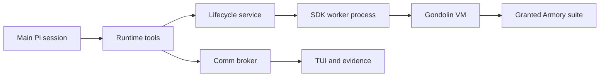

_Saga type: infrastructure. Status: open. Repository: `pi-automata-crew`._

---

## Design Doc

### Problem

Pi Crew is an alpha runtime, not a Claude Code skill port. It must reliably launch, dispatch,
isolate, observe, and clean up a Crew while giving each role only the tooling and network access it
needs. Today the runtime core works, but the repository bootstrap, default-deny guest networking,
failure-path evidence, durable lifecycle design, and typed tooling remain incomplete.

**Affected:** maintainers need an independently runnable Pi repository; invokers need Crew runs
that are safe, diagnosable, and bounded; workers need the operations required for their assigned
role without a general shell by default.

**Success horizon:** a maintainer can validate the runtime in CI, start a representative isolated
Crew, see bounded state and evidence, and trust that its network, credentials, tools, and cleanup
follow explicit policy.

### Scope

**In scope:**

- repository documentation, CI, test/format policy, and truthful operational status;
- Crew dispatch, Comm, lifecycle, TUI, evidence, and failure-path validation;
- one isolated Gondolin VM per worker, scoped credentials, and default-deny egress;
- Armory typed tooling and narrow role grants, beginning with GitHub workflow inspection;
- lifecycle state/audit/retry design before persistence implementation.

**Out of scope:**

- porting Claude Code skills, methodology, or their evaluation harness;
- copying the Claude plugin’s full tool surface;
- Docker/container workflow emulation, project dependency installation in Armory, and guest git;
- durable lifecycle implementation before its state contract is agreed.

**Dependencies:** Pi SDK subagent API, Gondolin, released Armory artifacts, and a narrowly scoped
GitHub credential for GitHub operations.

**Risks:** guest egress is presently open; lifecycle state is in memory; missing typed operations
can block a bash-less role; active isolated workers cost about 295 MB with libkrun.

### Why this is not the Fabric design

The prior exploration used `pi-fabric`/mesh and assumed a migration of Hall methodology. That path
was abandoned. The implemented runtime is built from the Pi SDK subagent API, explicit Comm and
Lifecycle services, and Gondolin guest proxies. Fabric remains historical evidence for why durable
coordination, narrow tools, and worker isolation matter; it is not an implementation dependency or
product target.

### System design

Main creates a ready Crew; explicit dispatch begins work. Comm carries actor-scoped messages and
typed work state; Lifecycle owns worker processes and cleanup; each Gondolin worker owns a private
VM and workspace. Armory exposes only granted operations through guest proxies. The target policy
is default-deny egress and no `bash` unless a role has an explicit exception.

### Open points

- Lifecycle durability, replay, idempotency, and linked retry attempts need a written contract.
- The release path must make typed suites cheap enough to keep bash-less roles productive.
- The active-worker memory cost requires a human policy decision before weakening isolation.

### Verification criteria

| #   | Criterion                                | How to prove                                                                                           |
| --- | ---------------------------------------- | ------------------------------------------------------------------------------------------------------ |
| 1   | Repository is independently maintainable | README, corrected scripts, CI runs `npm ci` and the deterministic Node suite.                          |
| 2   | Guest egress is least privilege          | Unlisted hosts are denied with and without credentials; denied host is observable.                     |
| 3   | Runtime failure paths are safe           | Launch failure retires roster/TUI; real owner-death run leaves no workers, VMs, worktrees, or servers. |
| 4   | GitHub tooling is bounded                | Typed workflow inspection returns structured summaries and bounded failure logs.                       |
| 5   | Lifecycle evolution is implementable     | State/audit/retry contract defines ownership, transitions, recovery, and evidence retention.           |

---

## Plan

| Issue | Deliverable                                       | Status |
| ----- | ------------------------------------------------- | ------ |
| #1    | Functional Pi Crew runtime and tooling alpha      | open   |
| #26   | Repository bootstrap, docs, CI, format policy     | open   |
| #27   | Default-deny Gondolin egress                      | open   |
| #28   | Failure-path runtime evidence                     | open   |
| #14   | Armory GitHub suite audit and workflow inspection | open   |
| #29   | Lifecycle state, audit, and retry specification   | open   |

---

## Bug Fixes

_No bug fixes filed under this Saga yet._
