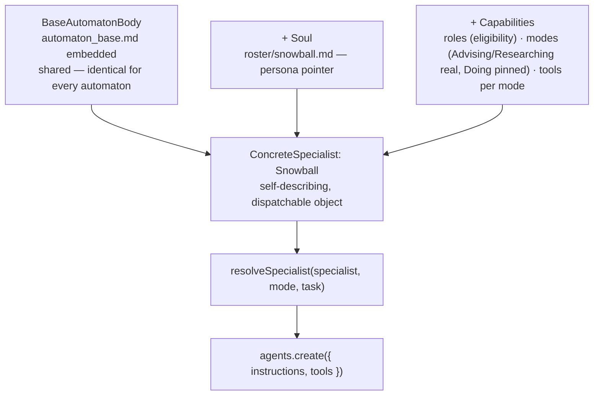
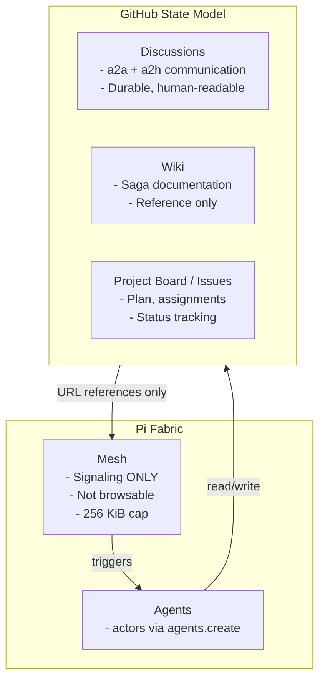
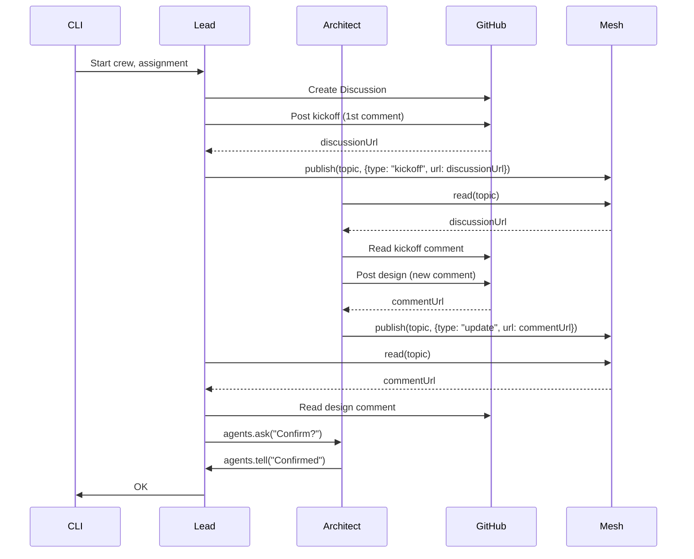

## Appendix — Automaton 2.0

A redefinition of what a Hall specialist *is*, developed while working KR 7.2. Not a Claude-plugin change — this exists only on `dev`, exercised for the first time by KR 7.2's own dispatch (#365/#366). Written down here because it changes the shape of every specialist dispatch from KR 7.3 onward, not just this one.

### The problem with the current shape

Today a specialist is one markdown file (`roster/<name>.md`), read and pasted into a subagent overlay wherever needed, with tool access decided ad hoc per invocation. Nothing about *what a specialist can be asked to do*, or *what it's granted for each*, is explicit or reusable — it lives in whoever's dispatching it remembering to get it right each time.

### Soul and body

**Soul** — `roster/<name>.md` only. Character, tone, domain, scope. Pure narrative, live-fetched from `hall-of-automata`, never cached (same discipline as everything else in this migration — GitHub is the state). Nothing structural belongs here.

**Body** — everything structural, newly made explicit:

1. **Base Contract** (`agents/automaton_base.md`) — shared, identical for every automaton, fetched once: environment rules, identity rules, output format, the **Modes table** (`Doing` / `Advising` / `Researching` — Hall's own real behavioral-mode vocabulary, reused rather than inventing new terms), and the draft-PR-on-blocker procedure. The Pi-side merge adapts this — GitHub-Actions-runner-specific content (`/github/workspace`, the `.hall/` checkout) doesn't apply to a Pi actor and is dropped, not blindly pasted.
2. **Mode capability profiles** — new, ours: for a chosen mode, which overlay contract applies and which tools get granted.

### A specialist is derived, not merged

A specialist isn't two peer things pasted together — it's a concrete object **derived from a shared base**, enriched with that specialist's own soul and capabilities. Closer to a base class and its instances than a pile of text files.

```ts
type BaseAutomatonBody = {
  baseContract: string; // agents/automaton_base.md, embedded, identical for every automaton
};

type ConcreteSpecialist = BaseAutomatonBody & {
  name: string;
  soul: { repo: "hall-of-automata"; path: `roster/${string}.md` }; // persona pointer, not raw text
  roles: string[];                                                    // from agents.json catalog.roles — eligibility source, never widens a tool grant
  modes: Partial<Record<Mode, ModeProfile>>;                          // capability per mode, chosen per dispatch
};

async function deriveSpecialist(name: string): Promise<ConcreteSpecialist> {
  const base = await fetchBaseAutomatonBody();          // shared, same call for every specialist
  const { catalog } = await fetchAgentsJsonEntry(name);  // roles only — eligibility, not tools

  return {
    ...base,
    name,
    soul: { repo: "hall-of-automata", path: `roster/${name}.md` },
    roles: catalog.roles,
    modes: {
      advising:    { overlay: "consultation", tools: ["local.read", "github.read", "github.comment"] },
      researching: { overlay: "consultation", tools: ["local.read", "github.read", "github.comment"] },
      // doing: pinned — not attached until a future saga explicitly authorizes real code writing
    },
  };
}
```

`deriveSpecialist("snowball")` produces one self-describing, dispatchable object — everything Snowball can be asked to do, and under what constraint, in one place. `resolveSpecialist(specialist, mode, task)` is then a thin final step: pick a mode, merge `baseContract + soul + mode overlay + task` (matching the Claude-plugin's own existing assembly order — base first, persona second, task-specific contract third), and produce `agents.create()`'s `{instructions, tools}`.

### Our own tool taxonomy — not a literal port of Hall's MCP tool names

| Label | Grants |
|---|---|
| `local.read` | Fabric core `read`/`grep`/`find`/`ls` |
| `github.read` | `pi-git-extension` read ops |
| `github.comment` | `pi-git-extension` comment ops |
| `github.write` | `pi-git-extension` write ops |
| `github.pr` | not built — needed only once `Doing` mode is unpinned |
| `local.edit` | Fabric core `edit`/`write` — not needed in current OKR 7 scope |
| `web.fetch` | `pi/web-fetch/` — built ahead of KR 7.3's research/fact-checking need, not yet exercised |
| `bash` | raw shell — avoid by default; only the KR 7.1-proven case (`gh api graphql` before a real component exists) |

`agents.json`'s declared `allowed_tools`/`catalog.roles` inform a specialist's *ceiling*; the tool grant for any one dispatch is always the mode's minimum, never the specialist's maximum.

### `Doing` — real code writing — is pinned, on purpose

Named and defined in the schema so its absence is a decision, not an oversight — not built, not attached to any specialist's `modes`, not dispatched by any current KR. The saga's own Migration Strategy already keeps real code-implementation dispatch (opening PRs) on the existing Claude Code plugin path, untouched by this migration; `Doing` staying pinned keeps that boundary honest rather than letting it drift open silently. Unpinning it is a decision for a future saga, not this one.

### Diagram



### Status

Conceptual, agreed, not yet implemented as code — KR 7.2's Items (#365, #366) are where `deriveSpecialist`/`resolveSpecialist` get built and proven for real, against Snowball, in `Advising` mode. This section is the blueprint those Items build to, not a retroactive description of something already running.


### Role-Based Refinement

The initial Specialist 2.0 design used a fixed three-mode enum (advising/researching/doing), bundling directive + tools + overlay into one monolithic "mode" — causing redundancy (directive text restated what tools already enforced) and rigidity (no way to tune model/effort per task type).

**Refined model**: Two orthogonal axes, not one.

#


## Crew State Model (GitHub-Only)

### Identity vs Capacity

**Identity** — fixed per specialist, extracted from persona definition:
- **Soul**: the character narrative, `roster/<name>.md`
- **Domain**: expertise areas, `agents.json` `catalog.domains`

**Capacity** — chosen per dispatch based on what the task needs:
- **Role**: `advisor | architect | researcher | developer | lead`
- Each role carries its own **discipline** (behavioral directive), optional **methodology** (fuller process), **tools**, and default **model**/**thinking** (effort level)
- Model/effort can be **dynamically overridden** per dispatch by the orchestrating lead based on task complexity — Fabric natively supports this via `agents.create` precedence (call override → session → project default)

### The Five Roles

| Role | Discipline | Methodology | Tools | Status |
|------|------------|-------------|-------|--------|
| `advisor` | Options, tradeoffs, one recommendation. Stop. | — (discipline sufficient) | `local.read`, `github.comment` | ✅ **Proven** — Snowball #366 dispatch |
| `researcher` | Grounded in what you read/fetched. No padding. | — | `local.read`, `web.fetch`, `github.comment` | Defined, not yet dispatched |
| `architect` | Propose approach + tradeoffs + diagram | `hall-saga` Phase 3 design methodology (to be ported) | `local.read`, `web.fetch`, `github.comment` | Named, methodology not yet written |
| `developer` | — | — | — | **Pinned, absent** — same as before |
| `lead` | — | The 4 responsibilities (Recruit/Watch/Review/Close) | `mesh.*`, `agents.tell/ask`, `github.comment` | Named for KR 7.3, documented, not yet wired |

**Tools**: kept loose for now — taxonomy-level only (`local.*`, `github.*`, `web.*`, `mesh.*`). Per-domain or per-repo scoping is future work.

**Eligibility**: checked against `catalog.roles` (same as before) — e.g., `developer` role requires `implement` catalog role when it's unblocked.

### Implementation Impact

- `lib/modes.mjs` → `lib/roles.mjs` (conceptual rename)
- `resolveSpecialist(name, mode, task)` → `installRole(specialist, role, task, override?)`
- `model`/`thinking` become first-class outputs alongside `instructions`/`tools`, fed directly into `agents.create`
- Redundancy eliminated: directive stays behavioral only, never restates what tools already enforce structurally
- Open registry: adding a new role (e.g., `triage`, `fact-check`) means adding one definition, not redesigning the type


### Hall State Model



**Principles:**
- Content lives on GitHub, never in mesh
- Write-then-tell: post to GitHub first, get URL, then notify
- Discussion = human visibility
- One Discussion per dispatch
- Mesh = trigger signaling only

### Crew Communication Model

